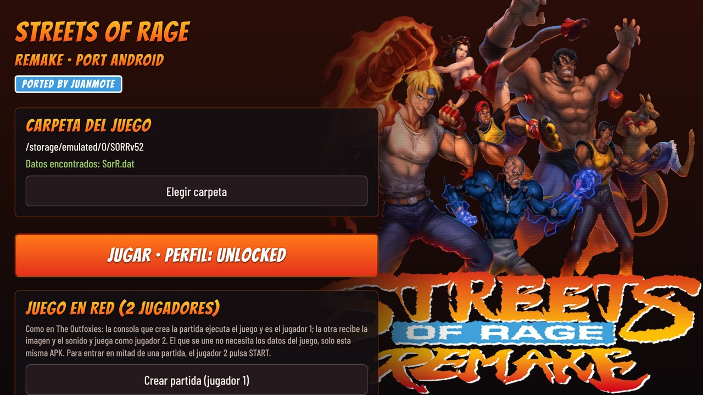
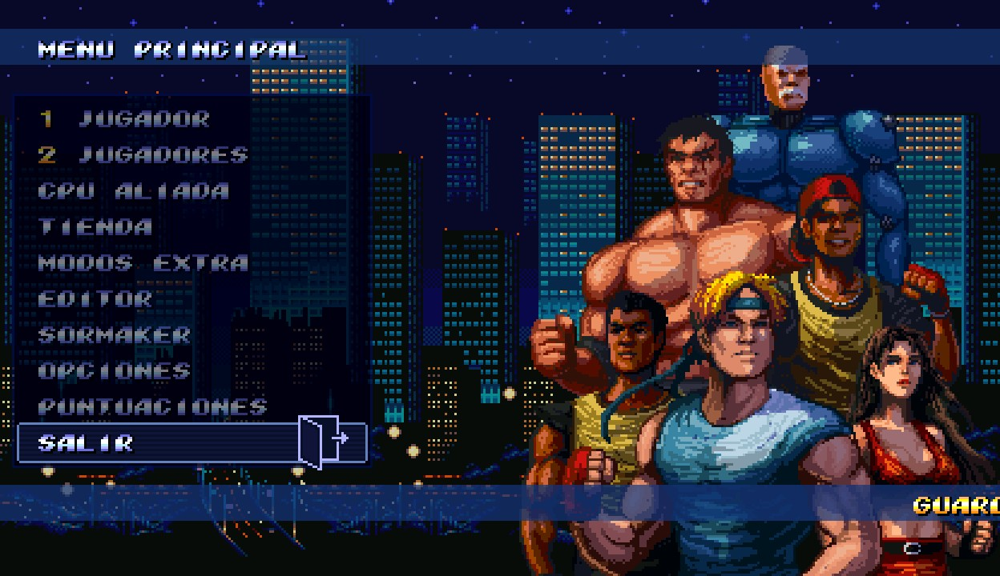
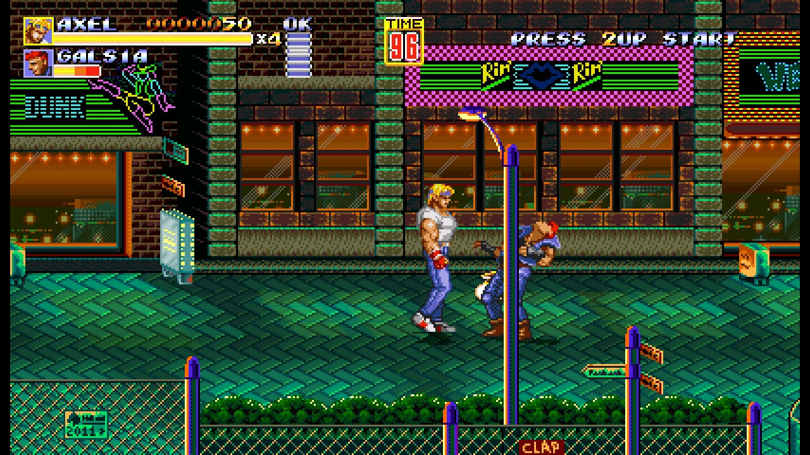
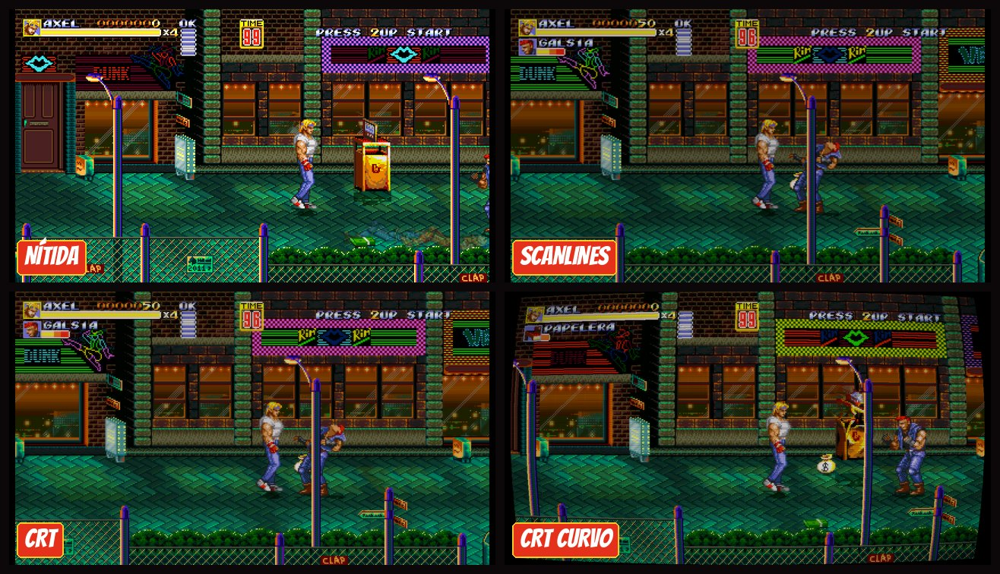
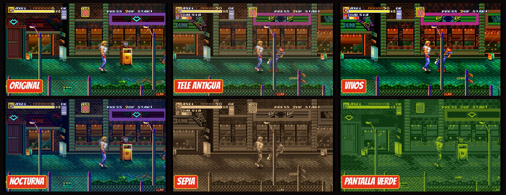
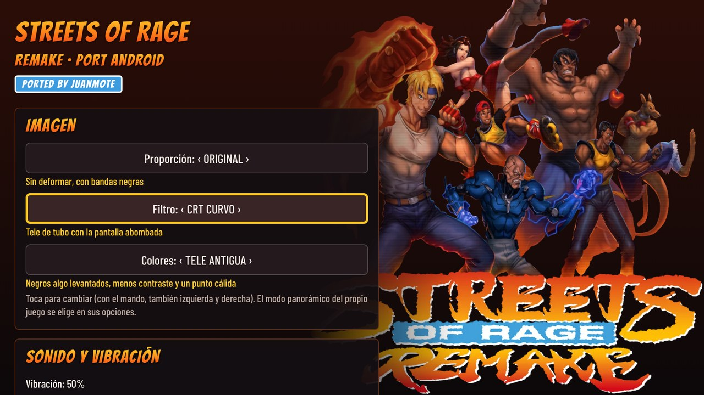
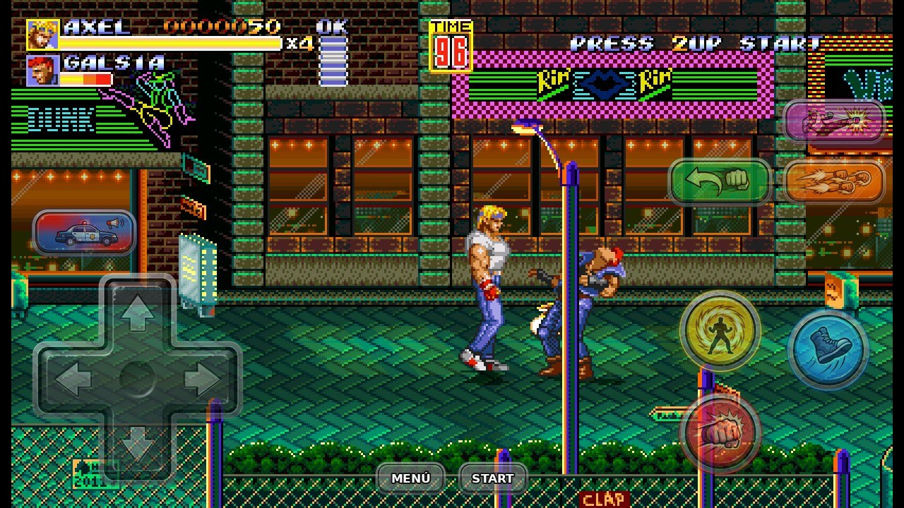
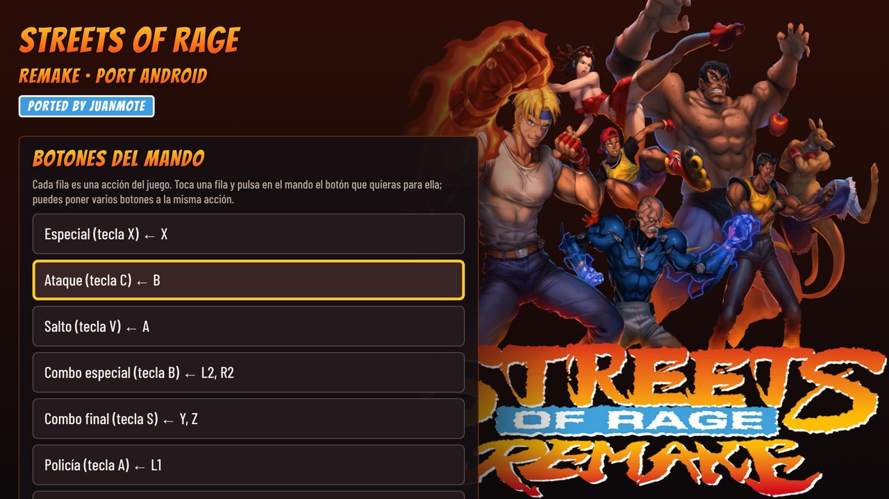
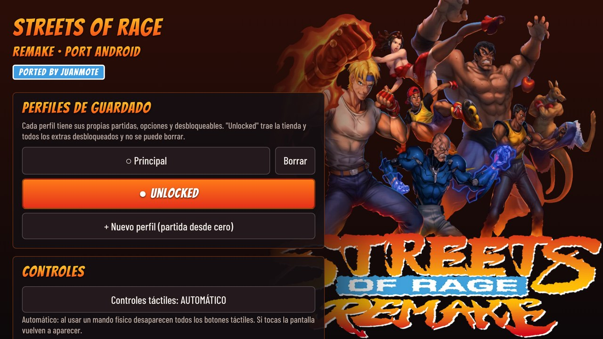

# Streets of Rage Remake · Android

**Port nativo de Streets of Rage Remake 5.2 para Android, hecho desde cero.**
Juego en red, filtros de imagen, controles táctiles propios, perfiles de guardado y un lanzador a medida.

**Ported by Juanmote**

---

## Qué es

Streets of Rage Remake es el remake fan de la saga de SEGA que publicó Bombergames en 2011 (freeware).
Este proyecto lo lleva a Android de forma **nativa**: el motor original del juego (BennuGD) compilado para
ARM de 64 bits sobre SDL2, sin emuladores ni capas intermedias, con un lanzador propio para configurarlo todo
antes de jugar.

No reutiliza nada de otros ports: motor, lanzador, controles, juego en red y filtros están hechos para este port.

 

## Cómo hacerlo funcionar

1. **Descarga la APK** de la [última versión](https://github.com/Juanmote/sorr-android/releases/latest) e instálala.
2. **Copia el juego de PC** (Streets of Rage Remake **v5.2**) a la consola: la carpeta que contiene
   `SorR.dat`, `mod/` y `palettes/`. Puede ir en la memoria interna o en la tarjeta SD.
   La APK no incluye los datos del juego.
3. **Abre el lanzador** y concede el permiso de archivos. El lanzador busca el juego solo en la memoria y en la
   tarjeta SD; si no lo encuentra, pulsa **Elegir carpeta** o **Escribir la ruta** (por ejemplo
   `/storage/XXXX-XXXX/SorR`). Vale señalar una carpeta que tenga el juego dentro de una subcarpeta.
   Cuando ponga *Datos encontrados: SorR.dat*, ya está.
4. Pulsa **JUGAR**.

> Para unirte a la partida de otra persona por red **no necesitas los datos del juego**: basta con la APK.

Requisitos: Android 9 o superior, procesador de 64 bits (arm64). Probado en AYN Odin 3.

## Mejoras de este port

### 🎮 Juego en red para 2 jugadores
Como en The Outfoxies: la consola que crea la partida ejecuta el juego y es el jugador 1; la otra recibe
imagen y sonido y juega como jugador 2.
- **Misma wifi**: el invitado encuentra la partida solo, sin escribir nada.
- **Por internet con un código de 8 letras**: apertura automática del router (UPnP) y, si no se puede
  (CGNAT, datos móviles…), un servidor intermedio para que funcione igual.
- También vale una IP directa (por ejemplo, de Tailscale).
- El jugador 2 puede entrar en mitad de una partida pulsando START.
- Imagen sin pérdida (solo se envía lo que cambia) y sonido comprimido de baja latencia.

### 🖥️ Filtros de imagen
Nítida, nítida suavizada, suavizada, scanlines, CRT y CRT curvo.

### 🎨 Perfiles de color
Original, tele antigua, vivos, nocturna, sepia y pantalla verde (cuatro tonos, como una portátil antigua).

### 📐 Proporción
Original (sin deformar), Recortar, Mixta y Estirada, para pantallas 16:9, 4:3 o casi cuadradas.

### 👆 Controles táctiles propios
Cruceta y botones dibujados para el port: Ataque, Salto y Especial a la derecha; Golpear atrás, Combo
especial y Combo final encima; Policía sobre la cruceta; MENÚ y START abajo en el centro. La parte de
arriba queda libre para el marcador.
- **Desaparecen por completo al usar un mando físico** y vuelven al tocar la pantalla.
- Opacidad y tamaño ajustables desde el lanzador.

### 🕹️ Mando físico listo para jugar
Funciona nada más conectarlo, sin configurar nada dentro del juego. Desde el lanzador se puede elegir qué
botón hace cada acción (admite varios botones por acción), incluidos los mandos de **seis botones**
(Retroid Pocket Classic, estilo Mega Drive/Saturn).

### 💾 Perfiles de guardado
Cada perfil tiene sus partidas, opciones y desbloqueables. El perfil **Unlocked** trae la tienda y todos los
extras abiertos (con los trucos apagados: cada uno activa los que quiera) y no se puede borrar.

### Y además
- 📳 **Vibración** en golpes, caídas, explosiones y la policía (en el mando si tiene motor; si no, en la consola), con intensidad ajustable.
- 🎵 **Música propia del lanzador**: un tema de rock ochentero en chiptune compuesto para este port (se puede apagar).
- 🌍 Lanzador en **castellano o inglés** según el idioma del sistema.
- ⏸️ El juego se pausa y se calla al minimizarlo o bloquear la pantalla.
- 🚪 Al salir del juego desde su menú se vuelve directamente a Android.
- 🧾 Si algo falla, se crean `sorr_log.txt` y `sorr_logcat.txt` en la carpeta del juego con los detalles.

## Controles de serie (mando)

| Acción | Botón |
|---|---|
| Ataque | B |
| Salto | A |
| Especial | X |
| Combo especial | L2 / R2 |
| Combo final | Y / Z |
| Policía | L1 |
| Golpear atrás | R1 / C |
| Start / pausa | Start |
| Menú / atrás | Select |

Todo se puede cambiar en **Controles › Configurar botones del mando**.

## Preguntas frecuentes

**¿Dónde consigo el juego?** Streets of Rage Remake v5.2 de PC. Copia la carpeta entera (con `SorR.dat`).

**No encuentra los datos.** Comprueba que la carpeta elegida contiene `SorR.dat` directamente, no dentro de otra subcarpeta.

**¿Dónde se guardan las partidas?** En la carpeta del juego (`savegame/` es el perfil activo; los demás, en `sorr_profiles/`). Desinstalar la APK no las borra.

**¿Cómo pongo el modo panorámico?** Se elige en las opciones del propio juego. La proporción del lanzador decide cómo se ajusta luego a tu pantalla.

---

## English

Native Android port of **Streets of Rage Remake 5.2** (BennuGD engine on SDL2, arm64), built from scratch.
Copy the PC game folder (`SorR.dat`, `mod/`, `palettes/`) to your device, install the APK, choose the folder
in the launcher and press **PLAY**. Features: 2-player network play (same wifi or internet with an 8-letter
code), CRT/scanline filters, colour profiles, aspect modes, custom touch controls that hide when a gamepad is
used, remappable gamepad buttons (six-button pads included), save profiles with an "Unlocked" one, rumble,
and a launcher in English or Spanish.

---

## Para desarrolladores

- `engine/` — bennugd-monolithic (de isage/sorr-vita) parcheado para Android arm64: asignador de memoria
  baja (<2 GB), arreglos de 64 bits, escalado/filtros/colores (`modules/libnet/sorrvideo.c`), juego en red
  (`modules/libnet/`), vibración, registro de fallos en `sorr_log.txt`.
- `app/` — lanzador en Java (sin Gradle), perfiles, controles táctiles, mando → teclas, y el código Java de SDL2.
- `native/` — CMake principal. Necesita junto a él, en `src/`: SDL2 `release-2.30.9`, SDL_mixer `release-2.8.0`
  y libpng `v1.6.44` (sin modificar).
- `build_apk.sh` — compila la APK sin Gradle (build-tools 35, NDK r27c).
- `.github/workflows/release.yml` — cada push a `main` compila y publica la APK firmada en Releases.
- `tests/` — programas BennuGD de prueba del motor de 64 bits.

## Créditos

- **Streets of Rage Remake** © Bombergames. Juego freeware, sin afiliación con SEGA.
- Motor **BennuGD** / bennugd-monolithic (josebagar, isage).
- Partidas base: PortMaster.
- Fuentes Bangers y Barlow (SIL OFL).
- Port, lanzador, juego en red, filtros y controles: **Juanmote**.
